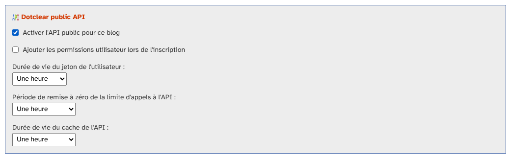
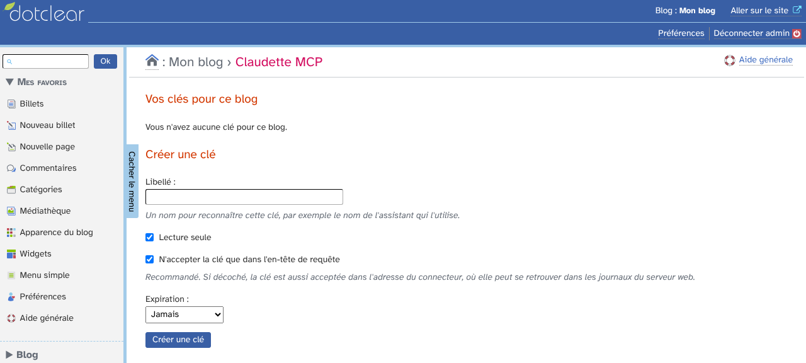
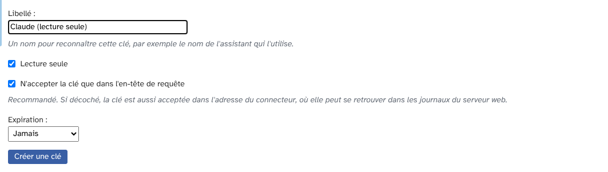
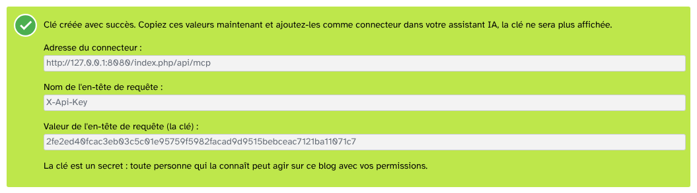
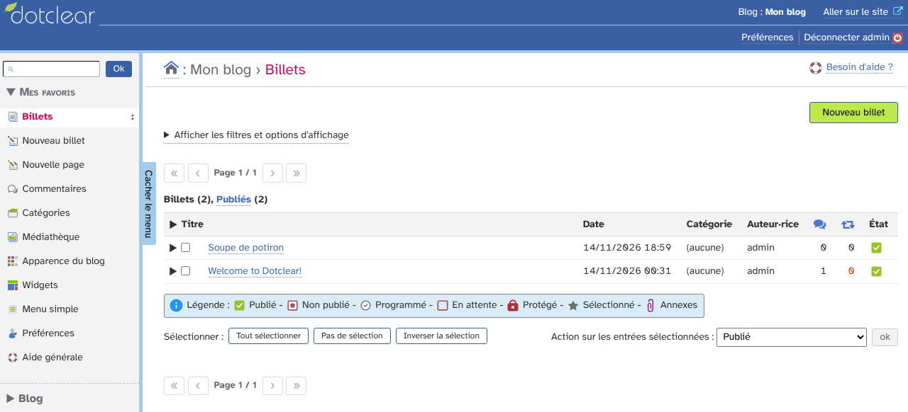
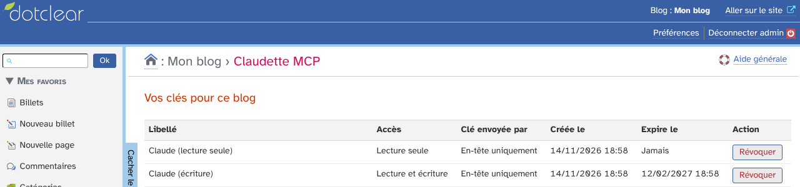

# ClaudetteMcp : guide d'utilisation

ClaudetteMcp permet à un assistant IA (Claude ou tout client MCP) de travailler sur votre blog Dotclear.
L'assistant utilise des outils : lire les billets, en créer, téléverser des médias, modérer les commentaires.
Il n'a pas besoin de navigateur ni de votre mot de passe : il utilise une clé.

## Sommaire

* [Avant de commencer](#avant-de-commencer)
* [Activer l'API sur le blog](#activer-lapi-sur-le-blog)
* [Créer une clé](#créer-une-clé)
* [Connecter votre assistant](#connecter-votre-assistant)
* [Ce que l'assistant peut faire](#ce-que-lassistant-peut-faire)
* [Gérer et révoquer les clés](#gérer-et-révoquer-les-clés)
* [Sécurité](#sécurité)

## Avant de commencer

Il vous faut :

* Dotclear 2.40 et PHP 8.3 ou plus récent ;
* le plugin ApiServer, installé et activé ;
* un utilisateur avec la permission « Client de l'API » ;
* un blog joignable depuis Internet en HTTPS, car l'assistant se connecte de l'extérieur.

## Activer l'API sur le blog

Ouvrez les paramètres du blog. Dans le bloc « Dotclear public API », cochez « Activer l'API public pour ce blog ».
Enregistrez.

Sans cela, la page du plugin affiche un avertissement et aucune clé ne fonctionne.

## Créer une clé

Ouvrez le menu « Blog », puis « Claudette MCP ».
Au début, la liste des clés est vide.

Remplissez le formulaire « Créer une clé » :

* **Libellé** : un nom pour reconnaître la clé, par exemple le nom de l'assistant ;
* **Lecture seule** : l'assistant peut lire le blog, mais rien y écrire ;
* **N'accepter la clé que dans l'en-tête de requête** : recommandé, la clé n'est pas acceptée dans l'adresse ;
* **Expiration** : jamais, ou dans 30, 90 ou 365 jours.

Cliquez sur « Créer une clé ».
La page affiche alors trois valeurs.

**Copiez-les tout de suite : la clé n'est affichée qu'une seule fois.**
Si vous la perdez, révoquez-la et créez-en une autre.

## Connecter votre assistant

Dans votre assistant, ajoutez un connecteur personnalisé (serveur MCP distant) :

1. Adresse : la valeur « Adresse du connecteur ».
2. Authentification : aucune connexion (« No sign-in »).
3. En-tête de requête : le nom `X-Api-Key`, avec la clé comme valeur.

Avec Claude, le connecteur s'ajoute à la main dans les réglages des connecteurs.
Après l'ajout, validez les outils proposés.

## Ce que l'assistant peut faire

Avec une clé en lecture seule :

* `get_blog` : les informations du blog et vos permissions ;
* `list_posts` et `get_post` : lister et lire les billets ;
* `list_categories` et `list_tags` : les catégories et les mots-clés ;
* `list_media` : la médiathèque ;
* `list_comments` : les commentaires.

Avec une clé en lecture et écriture, en plus :

* `create_post` : créer un billet. Il n'est jamais publié, il reste non publié ;
* `update_post` : modifier un billet ;
* `set_post_status` : publier ou dépublier, si vous avez la permission de publier ;
* `create_category` : créer une catégorie ;
* `upload_media`, `attach_media` et `detach_media` : téléverser un média et le lier à un billet ;
* `set_comment_status` : modérer un commentaire.

Les pages ne sont accessibles que si le plugin Pages est actif et que vous avez sa permission.
D'autres plugins peuvent ajouter leurs propres outils.

Voici un billet créé par l'assistant, puis publié sur demande :

L'assistant ne supprime jamais de contenu.
Il ne touche pas aux réglages du blog, aux utilisateurs, aux plugins ni aux clés.

## Gérer et révoquer les clés

La liste « Vos clés pour ce blog » montre pour chaque clé son libellé, son accès, la façon dont elle est envoyée, sa date de création et son expiration.

Pour retirer l'accès à un assistant, cliquez sur « Révoquer » en face de sa clé.
Il est refusé aussitôt.
Une clé expirée cesse aussi de fonctionner.

## Sécurité

* Une clé ne donne jamais plus que vos permissions Dotclear.
* La clé n'est conservée que sous forme chiffrée : personne ne peut la relire.
* Toute personne qui connaît la clé peut agir sur le blog avec vos permissions. Gardez-la secrète.
* Préférez l'en-tête de requête : dans l'adresse, la clé peut se retrouver dans les journaux du serveur web.
* Sans clé valide, le serveur ne répond qu'aux demandes d'initialisation.
